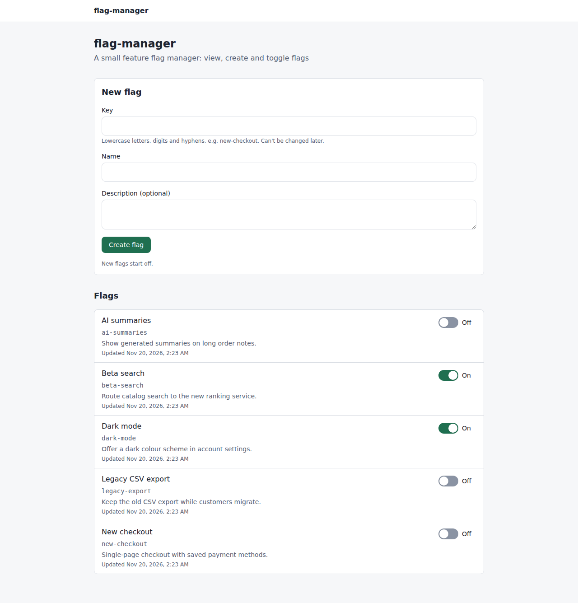

# flag-manager

A small feature flag manager: one page to see every flag, turn it on or off, and create new ones.
It is a React app on top of a Hono API with SQLite, built as the first iteration of something a team would keep extending.



## How to run

Prerequisites: **Node 24** and **pnpm**. `corepack enable` provides the pinned pnpm version. The Node 24 install must be the one on your `PATH`: if your shell defaults to another Node (for example through nvm), the commands below fail with `pnpm: not found`.

```bash
pnpm bootstrap   # creates .env from .env.example, installs dependencies, applies migrations, generates the API client
pnpm dev         # API on http://localhost:8000, web on http://localhost:5173 (Ctrl+C stops both)
pnpm test        # API tests, then web tests
pnpm check       # everything CI runs: format, lint, types, tests, API client freshness
```

Open http://localhost:5173. On first start the API creates the SQLite file (`apps/api/data/app.db`), applies the migrations and adds five sample flags. To start over, stop `pnpm dev`, delete that file and start again.

Other tasks: `pnpm gen-client` regenerates the API client after a route or schema change, and `pnpm db:migrate` applies migrations by hand. The same tasks exist as [just](https://just.systems) recipes (`just setup`, `just dev`, `just test`, `just check`); run `just` to list them.

## What's in it

```
apps/api/                  Hono API (Node 24 runs the TypeScript directly)
  src/routes/              HTTP only: OpenAPI route definitions and thin handlers
  src/schemas/             Zod request and response schemas; also the source of the OpenAPI document
  src/services/            Rules: new flags start off, PATCH sets a state, domain event logs
  src/db/                  Drizzle schema, flag repository, startup migrate and seed
  src/core/                env, logger, error envelope, request log
  drizzle/                 SQL migrations
apps/web/                  React app (Vite, TanStack Query, Tailwind)
  src/features/flags/      the page: list, row with switch, create form, data hooks
  src/components/ui/       Button and Switch
  src/index.css            theme tokens: every colour, space and font as a CSS variable
packages/api-client/       TypeScript client and TanStack Query hooks generated from the OpenAPI document
docs/adr/                  architecture decisions
```

The path of a request, for example turning a flag on:

1. **Web:** the switch moves at once. `features/flags/api.ts` calls the generated `setFlagEnabled` hook from `packages/api-client`. Vite proxies `/api` to the API.
2. **Middleware** (`app.ts`): assigns the request ID, then writes one request-log line when the response leaves.
3. **Route** (`routes/flags.ts`): Zod validates the path and body. A failure returns 422 before any logic runs.
4. **Service** (`services/flags.ts`): applies the rules, throws domain errors, and logs a `flag.state_changed` event.
5. **Repository** (`db/flag-repository.ts`): Drizzle runs one `UPDATE … WHERE enabled <> ? RETURNING` against SQLite.
6. **Errors:** anything thrown becomes the error envelope in `app.onError`. On failure the web app rolls the switch back and offers Retry.

The web app never declares API types by hand. The API's Zod schemas produce the OpenAPI document, the client is generated from it, and `pnpm check` fails if the generated client is stale.

## API reference

Base path `/api/v1`. JSON in and out. Every response carries an `X-Request-Id` header: a well-formed incoming one (up to 255 characters of letters, digits, `_`, `-`, `=`) is reused, and anything else is replaced with a new UUID. The full contract is in `packages/api-client/openapi.json`.

| Method | Path | Body | Success | Errors |
|---|---|---|---|---|
| GET | `/flags` | | 200 `{ "items": Flag[] }`, ordered by key | |
| POST | `/flags` | `{ key, name, description? }` | 201 the created flag, always `enabled: false` | 422 `validation_error`, 409 `flag_key_conflict` |
| PATCH | `/flags/{key}` | `{ "enabled": boolean }` | 200 the flag | 422 `validation_error`, 404 `flag_not_found` |

A flag:

```json
{
  "key": "new-checkout",
  "name": "New checkout",
  "description": "Single-page checkout with saved payment methods.",
  "enabled": false,
  "createdAt": "2026-11-20T10:00:00.000Z",
  "updatedAt": "2026-11-20T10:00:00.000Z"
}
```

Field rules:

- `key`: 2–64 characters of lowercase letters, digits and hyphens. It starts with a letter and has no trailing or double hyphen. It is unique (enforced by the database) and can't be changed.
- `name`: trimmed, 1–80 characters.
- `description`: optional and trimmed, at most 280 characters. A missing description is stored as `""`.
- Timestamps are set by the server, in UTC, with one-second precision.
- Unknown fields in a request body are rejected.

`PATCH` sets a state; it does not flip one. Repeating a request returns the same flag. When the flag is already in the requested state, nothing is written, no event is logged and `updatedAt` stays the same, so retries and double clicks are safe.

Every error has the same shape:

```json
{
  "code": "flag_key_conflict",
  "message": "A flag with key \"dark-mode\" already exists",
  "details": { "key": "dark-mode" },
  "requestId": "3f6c2a9e-8f0b-4d7e-9a51-2c1e4b7d9f00"
}
```

| Status | `code` | When |
|---|---|---|
| 422 | `validation_error` | The body or a field breaks a rule. `details.issues` lists each problem with its `path` (for example `["key"]`) and `message`. |
| 409 | `flag_key_conflict` | The key already exists. |
| 404 | `flag_not_found` | No flag has that key. |
| 404 | `not_found` | Unknown route. |
| 400 | `http_error` | The body is not valid JSON. |
| 415 | `http_error` | The request has a body but no `Content-Type: application/json` header. |
| 500 | `internal_error` | Anything unexpected. No stack traces or SQL are returned. The `requestId` matches the server's log lines. |

`requestId` is in the body as well as the header because people report errors by pasting the body. [ADR 0002](docs/adr/0002-request-id-in-error-body.md) explains the decision.

## Assumptions
<!-- Carlos: from the decision log -->

## Tradeoffs chosen on purpose
<!-- Carlos: from the decision log -->

## What was left out, and why
<!-- Carlos: the spec's "Out" list -->

## With another day
<!-- Carlos: ordered -->

## How it would grow in a larger platform
<!-- Carlos -->

## Time and process
<!-- Carlos: scaffolded from a personal template (v0.1.2); about 60 minutes of build -->
